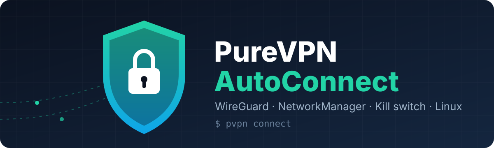

<p align="center">
  
</p>

<p align="center">
  <a href="https://github.com/SiNaPsEr0x/purevpn-autoconnect/stargazers"></a>
  <a href="https://github.com/SiNaPsEr0x/purevpn-autoconnect/releases"></a>
  <a href="https://github.com/SiNaPsEr0x/purevpn-autoconnect/network/members"></a>
  <a href="LICENSE"></a>
  <a href="https://github.com/SiNaPsEr0x/purevpn-autoconnect/commits/main"></a>
</p>

<p align="center">
  <a href="README.md">🇮🇹 Italiano</a> &nbsp;·&nbsp; 🇬🇧 <b>English</b>
</p>

# PureVPN AutoConnect

**A single Bash script that connects your Linux machine to PureVPN over WireGuard: it logs in by itself, fetches the configuration, imports it into NetworkManager, brings the tunnel up and protects you with a kill switch.**

> Independent, unofficial project: not affiliated with or endorsed by PureVPN. "PureVPN" is a trademark of its respective owners.

## What it does

Without AutoConnect, using WireGuard with PureVPN means logging in to the website, generating a config file by hand, downloading it, importing it, and repeating everything when it expires. The script does it all for you:

1. **Automatic login** to your PureVPN account, with **2FA** support (authenticator app code).
2. **Generates the WireGuard configuration** for the country and city you pick. The private key is created on your machine and is never sent to PureVPN.
3. **Imports it into NetworkManager** and brings the tunnel up, so you can also manage it from your desktop.
4. **Kill switch** (nftables): while the VPN is on, all traffic that does not go through the tunnel is blocked. If the tunnel drops, you never leak your real IP.
5. **Anti-leak**: disables system IPv6 while the VPN is active, flushes the DNS cache and closes already-open connections so apps reconnect through the VPN.
6. **Automatic refresh** every 15 minutes (systemd user timer) to keep the configuration valid.
7. **Server menu**: 66 countries and 80 cities to choose from.
8. **Tailscale-friendly**: its traffic is not blocked by the kill switch.

## Requirements

- Linux with **NetworkManager**, **systemd** and **nftables** (tested on Fedora KDE)
- `nmcli`, `wg` (wireguard-tools), `curl`, `jq`, `sudo`
- An active PureVPN subscription

On Fedora: `sudo dnf install NetworkManager wireguard-tools curl jq nftables`

## Installation

```bash
git clone https://github.com/SiNaPsEr0x/purevpn-autoconnect.git
cd purevpn-autoconnect
./purevpn-wg setup
```

`setup` asks for your PureVPN email and password, generates the keys and creates the **`pvpn`** alias (and a `~/.local/bin/pvpn` command). If credentials already exist it does not ask again: it only completes what is missing (keys, config, alias). Open a new terminal (or `source ~/.bashrc`) and you are ready.

PureVPN protects its website with Cloudflare, which blocks plain `curl`. If login fails with a block error, run once:

```bash
pvpn install-impersonate
```

It downloads `curl-impersonate` (SHA-256 verified) into `~/.local/share/purevpn-wg/`.

## Usage

```bash
pvpn connect          # menu: pick country and city (Enter = last used)
pvpn connect DE       # straight to Germany
pvpn connect US 8778  # country + city ID (e.g. New York)
pvpn status           # tunnel, kill switch, handshake, public IP, IPv6 leak check
pvpn disconnect       # stops tunnel, kill switch and refresh; restores the network
```

| Command | What it does |
|---|---|
| `setup` | Saves credentials (if missing), generates keys, creates the `pvpn` alias; safe to re-run |
| `connect [CC [CITY_ID]]` | Login, configuration, kill switch, connection |
| `disconnect` | Disconnects and restores network, IPv6 and DNS |
| `status` | Shows the full state |
| `refresh` | Regenerates the configuration (used by the timer) |
| `autorefresh on\|off` | Automatic refresh every 15 minutes (default: on) |
| `killswitch on\|off\|status` | Manual kill switch control |
| `locations` | List of available servers |
| `install-impersonate` | Downloads `curl-impersonate` to get past Cloudflare |
| `install-alias` | (Re)creates the `pvpn` alias and command |
| `logout` | Full sign-out: disconnects and deletes credentials, token and cookies |

## How it works, in short

```
pvpn connect
   │
   ├─ login at auth.purevpn.com (+ 2FA)  →  session token (cached)
   ├─ my.purevpn.com: subscription, VPN user, encrypted password
   ├─ get-wg-server  →  WireGuard configuration for the chosen server
   ├─ kill switch (nft table "purevpn_ks")  ← BEFORE the tunnel: no leak window
   ├─ nmcli: imports the "purevpn" connection and activates it
   └─ DNS flush · close stale connections · refresh timer
```

Where data is stored:

| What | Where |
|---|---|
| Email and password | `~/.config/purevpn-wg/credentials` (mode 600) |
| WireGuard key | `~/.config/purevpn-wg/client.key` (mode 600) |
| Token and configuration | `~/.cache/purevpn-wg/` (mode 600) |

No secret ends up in the repository or in logs; passwords never appear in process arguments.

## Limits and warnings

- **It uses unofficial endpoints** of the PureVPN website (there is no public API): they may change without notice and break the script. Use it at your own risk and check it is compatible with your subscription's terms.
- The **kill switch** needs `sudo` (password asked at `connect`). If the tunnel drops, the block stays until you run `pvpn disconnect`.
- If the **login token expires**, automatic refresh cannot redo 2FA on its own: run `pvpn connect` again.
- After `disconnect`, IPv6 takes a few seconds to come back.
- The cities in `locations.tsv` are not guaranteed for every subscription. More IDs can be found on the *Manual config* page of your PureVPN account.

## Removal

```bash
pvpn disconnect
nmcli connection delete purevpn
rm -rf ~/.config/purevpn-wg ~/.cache/purevpn-wg ~/.local/share/purevpn-wg
rm -f ~/.config/systemd/user/purevpn-wg-refresh.* ~/.local/bin/pvpn
# then remove the "# >>> purevpn-wg >>>" block from ~/.bashrc
```

## Credits

The login and generation flow was reconstructed by studying the behaviour documented by [TwoOnefour/purevpn-wg-auto-conf](https://github.com/TwoOnefour/purevpn-wg-auto-conf) and [Rikpat/purevpnwg](https://github.com/Rikpat/purevpnwg). [lexiforest/curl-impersonate](https://github.com/lexiforest/curl-impersonate) is used to get past Cloudflare. No code was copied from these projects.

## License

**Public domain ([Unlicense](LICENSE))**: you can copy, modify, publish and use this software for any purpose, including commercial, without asking permission. The software is provided "as is", without warranty of any kind.
