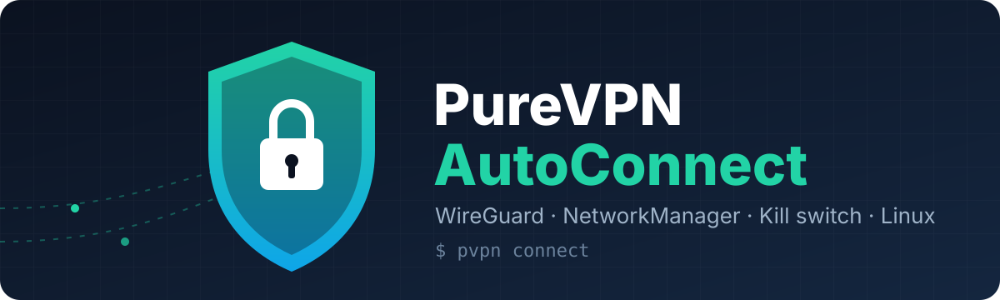
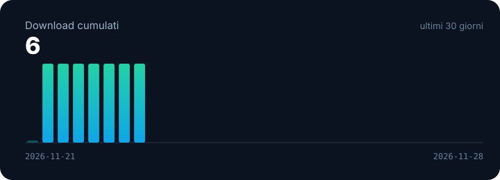
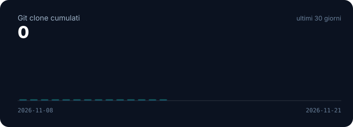

<p align="center">
  
</p>

<p align="center">
  <a href="https://github.com/SiNaPsEr0x/purevpn-autoconnect/stargazers"></a>
  <a href="https://github.com/SiNaPsEr0x/purevpn-autoconnect/network/members"></a>
  <a href="LICENSE"></a>
  <a href="https://github.com/SiNaPsEr0x/purevpn-autoconnect/commits/main"></a>
</p>

<p align="center">
  <a href="https://github.com/SiNaPsEr0x/purevpn-autoconnect/releases"></a>
  
</p>

<p align="center">
  🇮🇹 <b>Italiano</b> &nbsp;·&nbsp; <a href="README.en.md">🇬🇧 English</a>
</p>

# PureVPN AutoConnect

**Un solo script Bash che collega il tuo Linux a PureVPN con WireGuard: fa il login da solo, scarica la configurazione, la importa in NetworkManager, accende il tunnel e ti protegge con un kill switch.**

> Progetto indipendente e non ufficiale: non è affiliato né approvato da PureVPN. "PureVPN" è un marchio dei rispettivi proprietari.

## Cosa fa

Senza AutoConnect, usare WireGuard con PureVPN significa entrare nel sito, generare a mano un file di configurazione, scaricarlo, importarlo e ripetere tutto quando scade. Lo script fa tutto questo al posto tuo:

1. **Login automatico** all'account PureVPN, con supporto al codice **2FA** (app authenticator).
2. **Genera la configurazione WireGuard** per il paese e la città che scegli. La chiave privata viene creata sul tuo PC e non viene mai inviata a PureVPN.
3. **La importa in NetworkManager** e accende il tunnel. Si gestisce anche dal tuo ambiente desktop.
4. **Kill switch** (nftables): finché la VPN è attiva, tutto il traffico che non passa dal tunnel viene bloccato. Se il tunnel cade, non esci con il tuo IP reale.
5. **Anti-leak**: disattiva l'IPv6 di sistema mentre la VPN è attiva, svuota la cache DNS e chiude le connessioni già aperte, così le app si riconnettono passando dalla VPN.
6. **Refresh automatico** ogni 15 minuti (timer systemd utente) per mantenere valida la configurazione.
7. **Menu dei server**: 66 paesi e 80 città tra cui scegliere.
8. **Compatibile con Tailscale**: il suo traffico non viene bloccato dal kill switch.

## Requisiti

- Linux con **NetworkManager**, **systemd** e **nftables** (testato su Fedora KDE)
- `nmcli`, `wg` (wireguard-tools), `curl`, `jq`, `sudo`
- Un abbonamento PureVPN attivo

Su Fedora: `sudo dnf install NetworkManager wireguard-tools curl jq nftables`

## Installazione

```bash
git clone https://github.com/SiNaPsEr0x/purevpn-autoconnect.git
cd purevpn-autoconnect
./purevpn-wg setup
```

`setup` ti chiede email e password PureVPN, genera le chiavi e crea l'alias **`pvpn`** (e il comando `~/.local/bin/pvpn`). Se le credenziali ci sono già, non le richiede: completa solo ciò che manca (chiavi, configurazione, alias). Apri un nuovo terminale (oppure `source ~/.bashrc`) e sei pronto.

PureVPN protegge il sito con Cloudflare, che blocca `curl` normale. Se il login fallisce con un errore di blocco, esegui una volta:

```bash
pvpn install-impersonate
```

Scarica `curl-impersonate` (con verifica SHA-256) in `~/.local/share/purevpn-wg/`.

## Uso

```bash
pvpn connect          # menu: scegli paese e città (Invio = l'ultimo usato)
pvpn connect DE       # direttamente la Germania
pvpn connect US 8778  # paese + ID città (es. New York)
pvpn status           # tunnel, kill switch, handshake, IP pubblico, leak IPv6
pvpn disconnect       # spegne tunnel, kill switch e refresh; ripristina la rete
```

| Comando | Cosa fa |
|---|---|
| `setup` | Salva le credenziali (se mancano), genera le chiavi, crea l'alias `pvpn`: rilanciabile senza danni |
| `connect [CC [CITY_ID]]` | Login, configurazione, kill switch, connessione |
| `disconnect` | Disconnette e ripristina rete, IPv6 e DNS |
| `status` | Mostra lo stato completo |
| `refresh` | Rigenera la configurazione (lo usa il timer) |
| `autorefresh on\|off` | Refresh automatico ogni 15 minuti (default: attivo) |
| `killswitch on\|off\|status` | Gestione manuale del kill switch |
| `locations` | Elenco dei server disponibili |
| `install-impersonate` | Scarica `curl-impersonate` per superare Cloudflare |
| `install-alias` | (Ri)crea l'alias `pvpn` |
| `logout` | Esce del tutto: disconnette e cancella credenziali, token e cookie |

## Come funziona, in breve

```
pvpn connect
   │
   ├─ login su auth.purevpn.com (+ 2FA)  →  token di sessione (in cache)
   ├─ my.purevpn.com: abbonamento, utente VPN, password cifrata
   ├─ get-wg-server  →  configurazione WireGuard per il server scelto
   ├─ kill switch (tabella nft "purevpn_ks")  ← PRIMA del tunnel: nessuna finestra di leak
   ├─ nmcli: importa la connessione "purevpn" e la attiva
   └─ flush DNS · chiusura connessioni vecchie · timer di refresh
```

Dove vengono salvati i dati:

| Cosa | Dove |
|---|---|
| Email e password | `~/.config/purevpn-wg/credentials` (permessi 600) |
| Chiave WireGuard | `~/.config/purevpn-wg/client.key` (permessi 600) |
| Token e configurazione | `~/.cache/purevpn-wg/` (permessi 600) |

Nessun segreto finisce nel repository né nei log; le password non compaiono negli argomenti dei processi.

## Limiti e avvertenze

- **Usa endpoint non ufficiali** del sito PureVPN (non esiste un'API pubblica): possono cambiare senza preavviso e rompere lo script. Usalo a tuo rischio e verifica che sia compatibile con i termini del tuo abbonamento.
- Il **kill switch** richiede `sudo` (password chiesta al `connect`). Se il tunnel cade resta il blocco finché non esegui `pvpn disconnect`.
- Se il **token di login scade**, il refresh automatico non può rifare il 2FA da solo: rilancia `pvpn connect`.
- Dopo `disconnect` l'IPv6 impiega qualche secondo a tornare.
- Le città dell'elenco (`locations.tsv`) non sono garantite per ogni abbonamento. Altri ID si trovano nella pagina *Manual config* del tuo account PureVPN.

## Rimozione

```bash
pvpn disconnect
nmcli connection delete purevpn
rm -rf ~/.config/purevpn-wg ~/.cache/purevpn-wg ~/.local/share/purevpn-wg
rm -f ~/.config/systemd/user/purevpn-wg-refresh.*
# poi togli il blocco "# >>> purevpn-wg >>>" da ~/.bashrc
```

## Ringraziamenti

Il flusso di login e generazione è stato ricostruito studiando il comportamento documentato dai progetti [TwoOnefour/purevpn-wg-auto-conf](https://github.com/TwoOnefour/purevpn-wg-auto-conf) e [Rikpat/purevpnwg](https://github.com/Rikpat/purevpnwg). Per superare Cloudflare viene usato [lexiforest/curl-impersonate](https://github.com/lexiforest/curl-impersonate). Nessun codice è stato copiato da questi progetti.

## Licenza

**[PolyForm Noncommercial 1.0.0](LICENSE)**: puoi usare, copiare, modificare e condividere questo software per scopi **non commerciali** (uso personale, studio, ricerca, hobby, organizzazioni senza scopo di lucro). **L'uso commerciale non è consentito** senza un accordo con l'autore. Chi ridistribuisce il software deve mantenere il file `LICENSE` e l'avviso di copyright. Il software è fornito "così com'è", senza alcuna garanzia.

> Nota: non è una licenza "open source" in senso stretto (la definizione OSI non ammette limiti all'uso commerciale). Le versioni pubblicate prima del cambio di licenza (commit con Unlicense) restano disponibili con i termini con cui erano state rilasciate.
